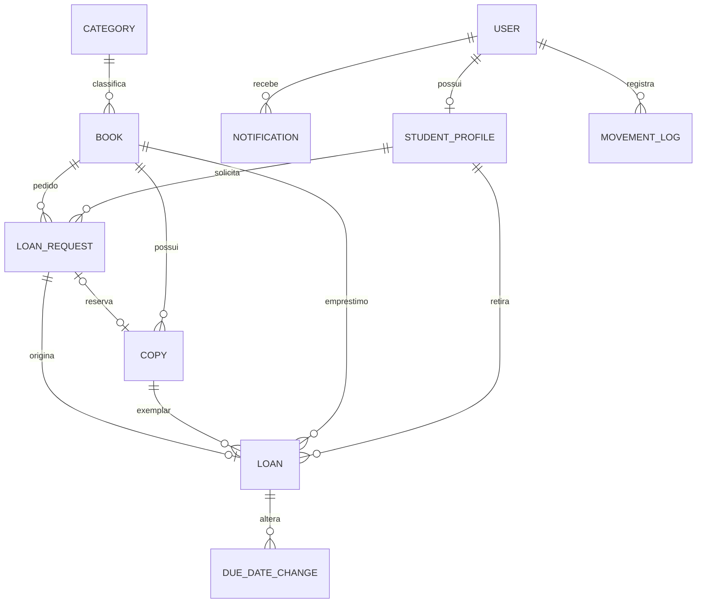
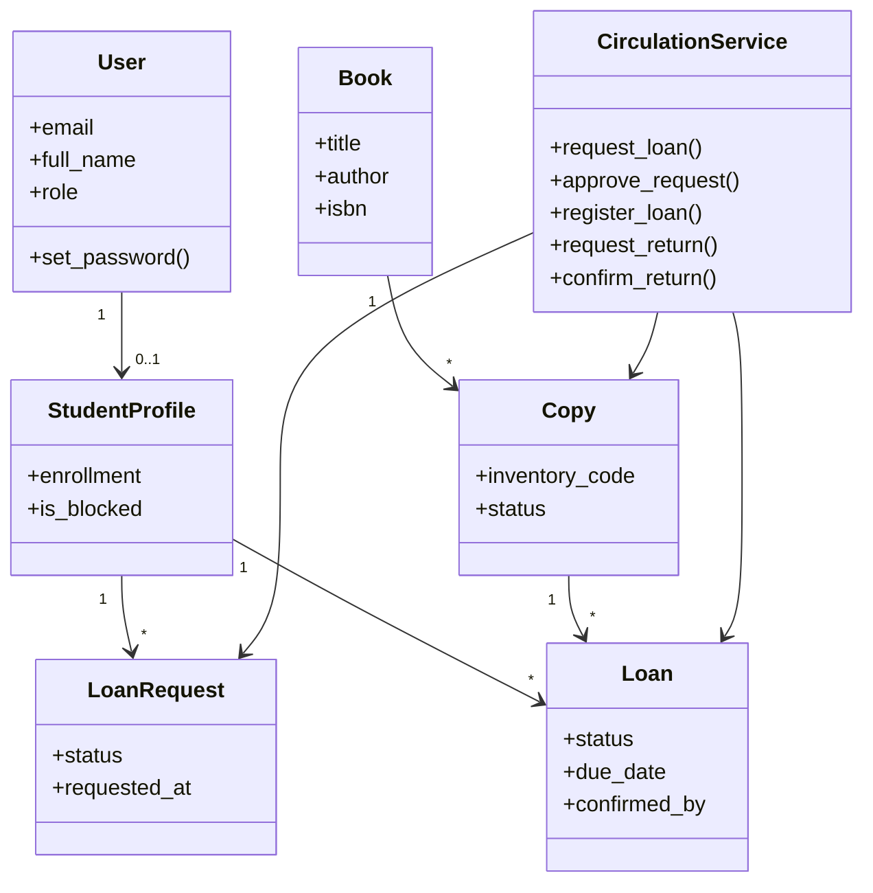
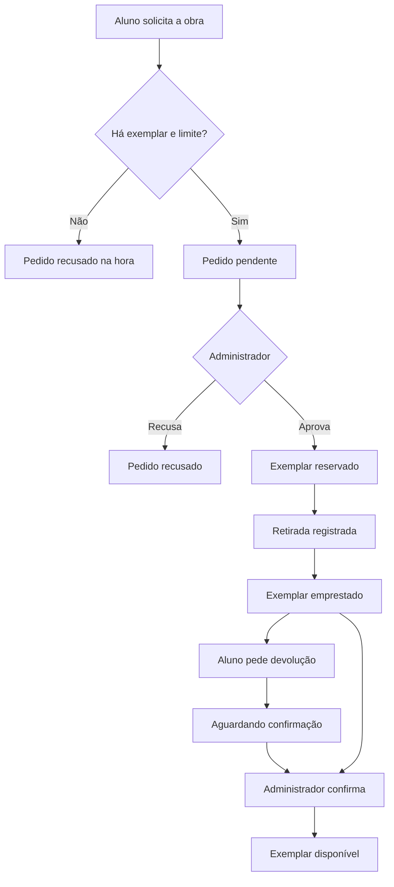

# Biblioteca Virtual Acervo

Documento de registro do sistema de biblioteca desenvolvido para uma instituição de ensino. A organização segue a lógica de um registro de atividade: identificação, objetivos, resultados, requisitos, diagramas, interfaces e verificação. O conteúdo descreve somente este sistema.

## Identificação

**Título da atividade:** Biblioteca Virtual Acervo

**Resumo:** O Acervo é um sistema web de biblioteca escolar. O aluno cria a própria conta com nome, matrícula, e-mail e senha, consulta o catálogo, vê quantos exemplares estão disponíveis e solicita empréstimo. A solicitação não retira o livro. Um professor ou administrador aprova, reserva um exemplar e, na retirada, registra o empréstimo. A devolução pedida pelo aluno fica aguardando confirmação. O exemplar só volta ao acervo quando a biblioteca confirma o recebimento. O sistema separa a área do aluno da área administrativa, guarda senhas com hash e registra as movimentações.

**Público atendido:** alunos e equipe da biblioteca de uma instituição de ensino. A quantidade de pessoas alcançadas deve ser preenchida pela instituição quando a atividade for apresentada. A validação feita neste desenvolvimento usou testes automatizados e um percurso manual no navegador.

**Ação desenvolvida:** implementação de software.

**Local ou demandante:** desenvolvimento para uso institucional, com banco local na fase inicial.

## Objetivos

**Objetivo geral:** centralizar o acervo e o ciclo de empréstimo para que o aluno consulte a biblioteca sem assumir o controle da devolução física, e para que a equipe administre livros, alunos e movimentações com registro de quem confirmou cada ato.

**Objetivos específicos:**

1. Permitir o cadastro real do aluno, com matrícula única, e-mail válido, confirmação de senha e senha armazenada com hash.
2. Autenticar aluno e administrador em entradas separadas, proteger rotas e encerrar a sessão.
3. Diferenciar a obra bibliográfica dos exemplares físicos e calcular a disponibilidade a partir desses exemplares.
4. Conduzir a solicitação, a aprovação, a retirada, o pedido de devolução e a confirmação administrativa sem que o aluno consiga encerrar o empréstimo sozinho.
5. Avisar alunos e administradores sobre aprovação, recusa, retirada, prazo, atraso e devolução, com controle de leitura.
6. Impedir exclusão de livro com empréstimo ou histórico vinculado e registrar as ações administrativas.

## Etapas

O trabalho foi organizado em planejamento da arquitetura, modelagem do banco, backend, autenticação, área do aluno, área administrativa, empréstimos, devoluções, notificações, documentação e testes. Cada regra que altera estoque ou status foi colocada no servidor, dentro de transação, e não apenas na tela.

## Resultados alcançados

### Área do aluno

- Cadastro com nome completo, matrícula, e-mail, senha e confirmação de senha.
- Recusa de matrícula ou e-mail já usados, com mensagem clara.
- Login por matrícula e senha, logout e recuperação de senha por código temporário.
- Painel com saudação, livros disponíveis, empréstimos ativos, solicitações pendentes, histórico e destaques do acervo.
- Catálogo com capa, ficha bibliográfica, totais e disponíveis, pesquisa por título, autor e ISBN, filtro por categoria e disponibilidade, ordenação e paginação.
- Página do livro com o botão **Solicitar empréstimo**, bloqueado quando não há exemplar, quando já existe solicitação aberta, quando o aluno já está com o livro ou quando o limite simultâneo foi atingido.
- Acompanhamento dos status Pendente, Aprovado, Emprestado, Aguardando confirmação, Devolvido, Atrasado e Recusado.
- Pedido de devolução que não libera o exemplar.

### Área administrativa

- Painel com totais de livros, exemplares, disponíveis, emprestados, solicitações, devoluções a confirmar, atrasos e alunos, além de barras de situação.
- Cadastro, edição e exclusão de livros, capa, categorias e quantidade de exemplares.
- Bloqueio da exclusão quando há empréstimo, reserva ou histórico.
- Consulta de alunos, edição de nome e e-mail, bloqueio e desbloqueio, histórico individual, sem exibição de senha e sem alteração da matrícula.
- Aprovação, que reserva um exemplar, e recusa, com motivo.
- Registro da retirada a partir da solicitação aprovada ou empréstimo direto no balcão.
- Alteração de prazo com motivo e histórico da mudança.
- Confirmação da devolução, inclusive quando o aluno entrega o livro sem ter pedido antes pelo sistema.
- Notificações com leitura individual e em lote.
- Histórico de movimentações.

## Requisitos funcionais

| ID | Requisito | Descrição | Prioridade |
| --- | --- | --- | --- |
| RF-001 | Cadastro do aluno | Registrar nome, matrícula única, e-mail válido, senha e confirmação | Alta |
| RF-002 | Login do aluno | Autenticar por matrícula e senha e manter a sessão | Alta |
| RF-003 | Login administrativo | Autenticar professor ou administrador por e-mail e senha | Alta |
| RF-004 | Recuperação de senha | Emitir código temporário e permitir a troca | Alta |
| RF-005 | Painel do aluno | Mostrar saudação, contadores, destaques e movimentação recente | Média |
| RF-006 | Catálogo | Listar obras com pesquisa, filtros, ordenação e paginação | Alta |
| RF-007 | Detalhe da obra | Exibir a ficha e a situação dos exemplares | Alta |
| RF-008 | Solicitar empréstimo | Registrar pedido sem dar baixa no exemplar | Alta |
| RF-009 | Acompanhar locações | Listar solicitações e empréstimos com o status de cada um | Alta |
| RF-010 | Pedir devolução | Marcar o empréstimo como aguardando confirmação | Alta |
| RF-011 | Painel administrativo | Exibir os indicadores gerais da biblioteca | Média |
| RF-012 | Gerir livros | Incluir, alterar, excluir e controlar exemplares e capas | Alta |
| RF-013 | Gerir categorias | Incluir e remover categorias sem livros vinculados | Média |
| RF-014 | Gerir alunos | Consultar, editar dados permitidos e bloquear contas | Alta |
| RF-015 | Analisar solicitações | Aprovar com reserva ou recusar com motivo | Alta |
| RF-016 | Registrar retirada | Criar o empréstimo e marcar o exemplar como emprestado | Alta |
| RF-017 | Acompanhar empréstimos | Filtrar ativos, atrasados e devolvidos e alterar prazos | Alta |
| RF-018 | Confirmar devolução | Concluir a devolução somente pela administração | Alta |
| RF-019 | Notificações | Avisar as partes e guardar o estado de leitura | Média |
| RF-020 | Histórico | Registrar ações administrativas e movimentações | Alta |

## Requisitos não funcionais

| ID | Requisito | Descrição | Prioridade |
| --- | --- | --- | --- |
| RNF-001 | Segurança da senha | Senha armazenada com hash, nunca devolvida pela API | Alta |
| RNF-002 | Autorização | Rotas de aluno e de administração separadas no cliente e no servidor | Alta |
| RNF-003 | Integridade | Mudanças de exemplar e de empréstimo feitas em transação | Alta |
| RNF-004 | Concorrência | Aprovação concorrente do último exemplar não pode reservar duas vezes | Alta |
| RNF-005 | Usabilidade | Interface clara, com retorno visual de sucesso e de erro | Alta |
| RNF-006 | Responsividade | Uso em computador, tablet e celular | Média |
| RNF-007 | Persistência | SQLite no desenvolvimento e configuração pronta para PostgreSQL | Alta |
| RNF-008 | Manutenção | Apps, serviços e páginas separados, sem concentrar as regras na tela | Média |
| RNF-009 | Rastreio | Cada confirmação guarda o administrador responsável | Alta |
| RNF-010 | Sessão | Token de acesso com renovação e encerramento por lista de bloqueio | Alta |

## Regras de negócio

1. A matrícula é única, gravada em maiúsculas, e o aluno não pode alterá-la.
2. Dois cadastros não podem usar o mesmo e-mail.
3. A senha e a confirmação precisam coincidir e ter ao menos 8 caracteres, sem ser apenas numérica.
4. Conta bloqueada não entra no sistema e não abre solicitação.
5. O livro é a obra. O exemplar é a unidade física, com código próprio e situação: disponível, reservado, emprestado ou indisponível.
6. A quantidade disponível é a contagem de exemplares disponíveis, não um número solto na ficha.
7. Solicitar empréstimo não muda a situação do exemplar.
8. Aprovar reserva um exemplar disponível. Se não houver exemplar na hora da aprovação, o pedido continua pendente.
9. Dois alunos podem pedir o mesmo último exemplar. Só uma aprovação consegue reservá-lo.
10. O empréstimo nasce quando a retirada é registrada. Aí o exemplar passa a emprestado.
11. O aluno não pode ter mais de um pedido aberto ou empréstimo aberto do mesmo livro.
12. A soma de pedidos abertos e empréstimos abertos não pode passar do limite definido pela administração.
13. Pedir devolução muda o empréstimo para aguardando confirmação e mantém o exemplar emprestado.
14. Somente administrador confirma a devolução. A confirmação grava data, responsável e devolve o exemplar à situação disponível.
15. O administrador pode confirmar a devolução mesmo sem pedido prévio do aluno.
16. Prazo alterado guarda a data anterior, a nova data, o motivo e quem alterou.
17. Empréstimo ativo com prazo vencido aparece como atrasado, sem deixar de ser um empréstimo em aberto.
18. Livro com empréstimo, reserva ou histórico não é excluído.
19. Reduzir a quantidade só remove exemplares disponíveis que nunca tiveram movimentação.
20. A senha do aluno não é exibida em nenhuma consulta administrativa.

## Atores

| Ator | O que faz |
| --- | --- |
| Aluno | Cadastra-se, consulta, solicita empréstimo e solicita devolução |
| Administrador | Professor ou servidor da biblioteca. Aprova, registra retirada, confirma devolução e mantém o acervo |
| Sistema | Reserva exemplar, calcula atraso, dispara aviso e impede operação duplicada |

## Casos de uso

| ID | Caso de uso | Ator | Resultado |
| --- | --- | --- | --- |
| UC-01 | Cadastrar-se | Aluno | Conta criada e sessão aberta |
| UC-02 | Entrar e sair | Aluno ou administrador | Sessão válida ou encerrada |
| UC-03 | Redefinir senha | Aluno ou administrador | Senha antiga deixa de valer |
| UC-04 | Consultar catálogo | Aluno ou administrador | Lista filtrada das obras |
| UC-05 | Solicitar empréstimo | Aluno | Pedido pendente, exemplar ainda disponível |
| UC-06 | Aprovar solicitação | Administrador | Exemplar reservado para aquele aluno |
| UC-07 | Recusar solicitação | Administrador | Pedido recusado com motivo, sem mexer no exemplar |
| UC-08 | Registrar retirada | Administrador | Empréstimo ativo e exemplar emprestado |
| UC-09 | Solicitar devolução | Aluno | Empréstimo aguardando confirmação |
| UC-10 | Confirmar devolução | Administrador | Empréstimo devolvido e exemplar disponível |
| UC-11 | Alterar prazo | Administrador | Nova data registrada no histórico |
| UC-12 | Bloquear aluno | Administrador | Conta impedida de entrar e de pedir livros |
| UC-13 | Manter acervo | Administrador | Obra, categoria e exemplares consistentes |

### UC-05 — Solicitar empréstimo

1. O aluno abre a obra.
2. O sistema verifica bloqueio, exemplar disponível, pedido duplicado, empréstimo aberto da mesma obra e limite simultâneo.
3. Se alguma regra falha, a tela explica o motivo e nada é gravado.
4. Se passa, o sistema grava a solicitação como pendente, avisa os administradores e não altera o exemplar.

### UC-06 e UC-08 — Aprovar e registrar a retirada

1. O administrador vê a fila pendente, com aluno, matrícula, livro, data e quantos exemplares estão livres.
2. Ao aprovar, o sistema trava a escolha do exemplar dentro de uma transação e marca um exemplar disponível como reservado.
3. Se outro administrador já reservou o último, a aprovação é recusada e o exemplar permanece como estava.
4. Na retirada, o administrador registra o empréstimo. O pedido aprovado vira retirada registrada, nasce o empréstimo e o exemplar fica emprestado, com prazo padrão ou data informada.

### UC-09 e UC-10 — Devolver

1. O aluno, em Meus empréstimos, pede a devolução de um livro emprestado.
2. O status passa a aguardando confirmação. O exemplar continua emprestado.
3. O administrador vê a fila, recebe o livro e confirma.
4. Só então o empréstimo fica devolvido, com data e nome de quem confirmou, e o exemplar volta a disponível.
5. Se o aluno entrega o livro sem pedir pelo sistema, o administrador confirma a devolução a partir do empréstimo ativo. O efeito no exemplar é o mesmo.
6. Uma chamada de aluno à rota de confirmação é recusada. Não existe botão de confirmação na área do aluno.

## Modelagem do banco

O banco separa quem usa o sistema, a obra, o exemplar e a circulação.

| Entidade | Papel | Campos principais |
| --- | --- | --- |
| User | Conta de acesso | e-mail único, nome, perfil aluno ou administrador, senha com hash |
| StudentProfile | Aluno | matrícula única, bloqueio, motivo, datas |
| PasswordResetToken | Troca de senha | código, validade, uso |
| Category | Classificação | nome único, descrição |
| Book | Obra | título, autor, editora, ISBN opcional único, ano, descrição, capa, localização |
| Copy | Exemplar físico | código único, situação, localização |
| LibraryPolicy | Regras | limite simultâneo, prazo em dias, antecedência do aviso |
| LoanRequest | Pedido | aluno, obra, exemplar reservado, status, parecer, motivo |
| Loan | Empréstimo | aluno, obra, exemplar, pedido de origem, status, retirada, prazo, devolução, confirmado por |
| DueDateChange | Mudança de prazo | prazo anterior, prazo novo, motivo, autor |
| MovementLog | Histórico | ação, descrição, ator, ligações opcionais |
| Notification | Aviso | destinatário, tipo, título, mensagem, lida ou não |

Restrições de integridade: um aluno não tem dois pedidos abertos da mesma obra; um exemplar não tem dois empréstimos abertos; obra, exemplar, aluno e pedido de origem dos empréstimos usam proteção contra exclusão em cascata quando isso apagaria o histórico.

### Diagrama entidade-relacionamento



Um usuário aluno tem um perfil. Uma obra tem vários exemplares. O pedido aponta para a obra e, depois da aprovação, para um exemplar reservado. O empréstimo aponta para um exemplar específico. Vários empréstimos históricos podem existir para o mesmo exemplar, mas apenas um empréstimo aberto.

### Diagrama de classes



`CirculationService` concentra as transições. As telas chamam a API. A API chama o serviço. O serviço é quem muda exemplar, pedido e empréstimo juntos.

### Fluxo de processos



A seta direta de emprestado para a confirmação cobre a entrega feita no balcão sem pedido prévio no sistema.

## Interfaces

### Entrada do aluno

Tela dividida: um painel com a identidade do Acervo e um cartão com matrícula, senha, entrada, recuperação de senha e link de cadastro. Credencial inválida permanece na tela com a mensagem do servidor. Conta bloqueada explica que é preciso procurar a biblioteca.

### Cadastro

Formulário com nome, matrícula, e-mail, senha e confirmação. O sucesso abre a área do aluno. Matrícula ou e-mail repetidos voltam com o motivo.

### Início do aluno

Saudação com o primeiro nome, quatro indicadores e uma faixa de obras em destaque, seguida dos títulos recentes e da movimentação do próprio aluno.

### Catálogo e detalhe

Grade de capas geradas quando não há imagem, com título, autor, categoria, ano e a fração de exemplares disponíveis. A página da obra mostra editora, ISBN, descrição e o botão de solicitação, ou o motivo pelo qual ela não pode ser feita.

### Meus empréstimos

Filtros por situação. O aluno vê pedido pendente, aprovação, empréstimo, espera de confirmação, atraso e histórico. O único ato sobre um livro emprestado é solicitar a devolução, depois de um aviso de que a biblioteca ainda precisa confirmar.

### Painel administrativo

Barra lateral escura com painel, livros, categorias, alunos, solicitações, empréstimos, histórico e regras. Os cartões levam à fila correspondente. As barras comparam disponíveis, emprestados, reservados, atrasados, devoluções e pedidos.

### Operação

Tabelas com busca. Aprovar, recusar, registrar retirada, confirmar devolução e alterar prazo abrem um painel de confirmação. A ficha do aluno mostra o histórico e deixa nome e e-mail editáveis. A matrícula aparece bloqueada e a senha não aparece.

## Arquitetura e tecnologias

O navegador fala com uma API REST. O frontend não decide sozinho se um exemplar pode ser emprestado.

| Camada | Tecnologia |
| --- | --- |
| Interface | React, TypeScript, Vite, React Router |
| Comunicação | Axios, token JWT no cabeçalho |
| API | Django e Django REST Framework |
| Acesso entre origens | Django CORS Headers |
| Sessão | SimpleJWT, com rotação e bloqueio do token de atualização |
| Banco de desenvolvimento | SQLite |
| Banco de produção | PostgreSQL, ativado pelas variáveis `POSTGRES_*` |
| Imagens | Pillow, capas em `media/covers` |

Pastas:

- `frontend/src/pages` telas do aluno, da administração e da entrada
- `frontend/src/auth` sessão
- `frontend/src/api` cliente HTTP
- `frontend/src/components` botões, modal, capa e avisos
- `backend/apps/accounts` usuário, aluno, login e senha
- `backend/apps/catalog` categorias, obras e exemplares
- `backend/apps/circulation` política, pedidos, empréstimos, prazos e histórico
- `backend/apps/notifications` avisos
- `backend/apps/common` erro de negócio e paginação
- `docs` este registro

## Módulos

**Contas.** Cadastro, dois logins, sessão, troca e redefinição de senha, criação do administrador por comando.

**Catálogo.** Listagem com anotações de total e disponíveis, escrita restrita à administração, geração de código de exemplar e mudança manual só entre disponível e indisponível quando o exemplar não está preso a uma circulação.

**Circulação.** Serviço único para pedir, aprovar, recusar, registrar, prorrogar, pedir devolução e confirmar. O painel do aluno e o painel administrativo leem esse mesmo estado.

**Notificações.** Um aviso por destinatário, com tipo, texto e leitura. A varredura de prazo e atraso roda quando os painéis e a lista de avisos são abertos, e também pelo comando `notify_due`, para uso agendado.

**Auditoria.** Cada transição relevante grava descrição, ator e ligações com aluno, obra, pedido ou empréstimo.

## Segurança

- Perfil `student` não passa nas permissões da administração. Perfil `admin` não usa as rotas exclusivas do aluno.
- Visitante sem token recebe não autorizado.
- Aluno bloqueado recebe recusa mesmo com token antigo.
- A confirmação de devolução existe apenas em rota administrativa.
- O corpo enviado pelo aluno na solicitação de devolução não escolhe o status final. O serviço fixa aguardando confirmação.
- A edição do aluno ignora matrícula e bloqueio. O bloqueio tem rota própria, com motivo.
- Senhas usam o hash do Django. Nenhuma consulta devolve o campo.
- A aprovação escolhe o exemplar com trava de linha dentro da transação, para duas aprovações não reservarem o mesmo último exemplar.
- O token de atualização pode ser invalidado no logout.

## Estratégia de testes

Os testes automatizados ficam em `apps/accounts/tests`, `apps/catalog/tests` e `apps/circulation/tests`. Eles cobrem:

- cadastro válido, matrícula repetida, e-mail inválido e senhas diferentes;
- senha armazenada com hash;
- login correto, login incorreto, conta bloqueada e logout com token invalidado;
- redefinição de senha;
- aluno impedido de abrir o painel administrativo;
- visitante impedido de ler o catálogo;
- cadastro, busca, alteração de quantidade e exclusão de livro sem movimento;
- pedido que não muda o exemplar;
- segundo pedido do mesmo aluno recusado;
- duas aprovações sobre um único exemplar, com a segunda recusada;
- retirada que marca o exemplar como emprestado;
- aluno recusado ao confirmar devolução, sem mudança de status;
- pedido de devolução que mantém o exemplar emprestado;
- confirmação administrativa que libera o exemplar e grava o responsável;
- exclusão recusada quando já existe histórico;
- limite simultâneo, recusa sem mexer no estoque, empréstimo direto e alteração de prazo;
- edição de aluno que não troca a matrícula nem revela senha.

Além dos testes, o percurso foi feito no navegador: login inválido, login da aluna, catálogo filtrado por autor, solicitação, pedido de devolução, login administrativo, aprovação, registro da retirada e confirmação. Depois da confirmação de *O Cortiço*, o exemplar `EX-035C22` ficou disponível e o empréstimo ficou devolvido em nome da coordenação da biblioteca.

## Verificação e correções

**Correção 1 — permissão composta.** A listagem do catálogo montava a permissão com instâncias já criadas e o operador de composição. Isso gerava erro de tipo e derrubava a consulta de quem já estava autenticado. A correção compõe as classes de permissão e só então cria o objeto usado pela API.

**Correção 2 — painel do aluno.** A montagem do painel lia os empréstimos e as solicitações antes de buscá-los. A consulta foi colocada antes dos contadores, para a saudação e os números saírem do banco.

**Conferência da devolução.** O pedido do aluno não foi tratado como baixa. A baixa ocorreu somente na confirmação administrativa, com o nome de quem confirmou gravado no empréstimo.

## Instalação e execução

1. Criar o ambiente virtual em `backend` e instalar `requirements.txt`.
2. Rodar `migrate`.
3. Rodar `seed_demo` ou `create_admin` para o primeiro administrador.
4. Em `frontend`, instalar os pacotes e subir o Vite.
5. Acessar a interface em `http://127.0.0.1:5173` e a API em `http://127.0.0.1:8000`.

O arquivo `.env.example` lista a chave, o modo de depuração, as origens permitidas, o prazo do token e o bloco comentado do PostgreSQL. Sem `POSTGRES_DB`, o arquivo usado é `backend/db.sqlite3`.

Para repetir a demonstração do zero:

```powershell
.\.venv\Scripts\python manage.py seed_demo --reset
```

## Considerações finais

O Acervo trata a biblioteca como circulação de exemplares, não como um contador único na ficha do livro. O aluno enxerga o acervo e conduz o pedido. A equipe da biblioteca é quem reserva, entrega e recebe. Essa divisão evita que uma solicitação de devolução libere o livro para outra pessoa antes de ele voltar à estante.
